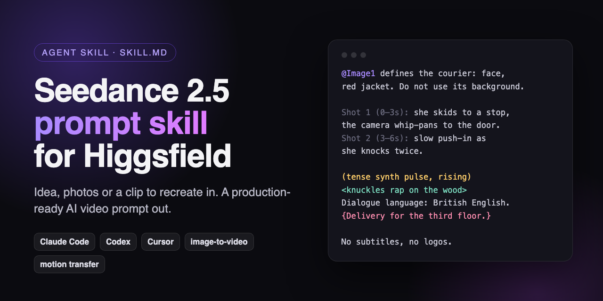

# Seedance 2.5 Prompt Skill for Higgsfield



[](LICENSE)
[](https://agentskills.io)
[](https://docs.claude.com/en/docs/claude-code/skills)

**An AI agent skill that writes Seedance 2.5 video prompts for [Higgsfield](https://higgsfield.ai).** Describe an idea, attach reference photos or a TikTok you want to recreate, and your agent returns a ready-to-paste prompt. The answer includes the `@Image` reference mapping, the settings to pick and fixes for when a generation fails.

It works in **Claude Code**, **Codex**, **Cursor** and any agent that supports the open [Agent Skills](https://agentskills.io) (`SKILL.md`) format. A walkthrough is on [jutsustudio.com](https://jutsustudio.com/blog/seedance-prompt-skill/).

- [Install](#install)
- [Example](#example)
- [What it covers](#what-it-covers)
- [Prompt examples](#seedance-prompt-examples)
- [Seedance 2.5 cheat sheet](#seedance-25-prompt-cheat-sheet)
- [FAQ](#faq)

## Install

```bash
git clone https://github.com/jutsuhq/higgsfield-seedance-prompt-skill ~/.claude/skills/higgsfield-seedance-prompt-skill
```

That installs it for all your Claude Code projects. For a single project, clone it into `.claude/skills/higgsfield-seedance-prompt-skill` inside that project instead. For another agent, copy the folder into that agent's skills directory.

Optional: `brew install ffmpeg` lets the skill analyse reference videos (duration, cuts, contact sheet).

## Example

**You:** "Animate this portrait of my character in the rain, 5 seconds, for TikTok." (with `rain-portrait.png` attached)

**The skill returns** settings (omni-reference, 9:16, 5 s) and the prompt:

```
@Image1 is the first frame and defines the young woman: her face, short black bob, yellow raincoat and the neon-lit wet street behind her. Keep the composition and lighting of @Image1 exactly.
Rain keeps falling as she slowly lifts her face toward the sky, closes her eyes, and a small smile spreads as the drops hit her cheeks; she pulls the hood back with one hand.
The camera holds still for a beat, then drifts in slowly to a close-up of her face.
The visuals keep the pink and blue neon reflections, the rain streaks in the light and soft film grain.
Audio: <steady rain on the pavement and on the raincoat hood> <distant traffic swishing through puddles>. No music, no dialogue.
Her face matches @Image1 in every frame. No text, no logos, no watermarks.
```

It also adds notes on what to change if the clip drifts or gets rejected.

## What it covers

- **Every Seedance 2.5 mode**: text-to-video, image-to-video and omni-reference (images, video, audio), first and last frame, video edit and video extension.
- **Recreating a viral video**: it analyses the source clip (duration, cut timestamps, contact sheet) instead of guessing, then rebuilds it with your character, product or car.
- **Motion transfer and swaps**: binds `@Video1` as the motion reference and `@Image1` as the identity, with exclusions so the original actor doesn't leak in.
- **Multi-shot montages from stills**: timed shots with clean hard cuts and no morphing.
- **30-second one-take stories**: staged so the second half doesn't drift.
- **Sound and dialogue**: Seedance's bracket syntax `( )` music, `< >` SFX, `{ }` dialogue, `【 】` captions, plus language and accent declarations.
- **Cinematic camera language**: dolly, orbit, whip pan, dolly zoom, FPV, lenses, lighting and film looks (35mm, VHS, early-90s TV).
- **Moderation-safe characters**: describes original characters and objects by appearance, with no names, brands or logos.
- **Preview-frame swaps**: keyframes at the beats, preview stills of your characters, face crops and a `TIMELINE` line, so a swap keeps faces, clothes and scale.
- **Realistic characters**: real-photo flaws, JSON image prompts and cartoon → live-action character packs, so people don't look AI-generated.
- **Fixing failed generations**: a symptom → cause → fix table for fused characters, uninvited music, random cuts, garbled text and face drift, plus swap failures (flipping capes, oversized characters, lost captions) and cutting glitches out in editing.

## Seedance prompt examples

Nine worked requests with full prompts, all written for this repository:

| Example | Mode |
|---|---|
| [Idea to an 8-second clip](examples/01-text-to-video.md) | Text-to-video |
| [Bring one photo to life](examples/02-animate-a-photo.md) | Image-to-video |
| [Cut several stills into one video](examples/03-stills-montage.md) | Multi-shot montage |
| [Repeat a viral clip with your character](examples/04-recreate-a-reference-video.md) | Motion reference |
| [Get from one still to another](examples/05-first-and-last-frame.md) | First and last frame |
| [Tell a 30-second story in one take](examples/06-30-second-one-take.md) | Staged one-take |
| [Two characters talking](examples/07-dialogue-scene.md) | Dialogue and accents |
| [Describe a character without names](examples/08-describe-a-character.md) | Character description |
| [Fix a failed generation](examples/09-repair-a-failed-generation.md) | Repair |

## Seedance 2.5 prompt cheat sheet

| | |
|---|---|
| Formula | `[Subject + Action] + [Scene] + [Visual style] + [Camera] + [Audio]` |
| Brackets | `(music)` `<sfx>` `{dialogue}` `【on-screen text】` |
| Dialogue | `Dialogue language: British English.` before every non-Chinese line |
| References | one reference = one subject, with a role and an exclusion |
| Beats | 8 s = 3–5 · 15 s = 4–6 · 30 s = 6–9 windows |
| Locks | state critical bans twice; numbers beat adjectives; end mid-motion |
| Limits | 4–30 s · up to ~50 references · 21:9 to 9:16 |

The full rules are in [`references/seedance-2.5.md`](references/seedance-2.5.md), and the camera and lighting terms in [`references/vocabulary.md`](references/vocabulary.md).

## FAQ

**What is Seedance 2.5?**
ByteDance's video generation model. It renders picture, dialogue, sound effects and music in one pass, up to 30 seconds, from text, images, video and audio references. Higgsfield is one of the platforms that runs it.

**How do I write a good Seedance prompt?**
Name a concrete subject and action, set the scene and visual style, write the camera as an ordered sequence, and give the audio at least two concrete sources. This skill applies that formula, plus the reference, timing and stability rules, automatically.

**Why does Higgsfield reject my prompt or reference image?**
Real public figures, recognisable copyrighted characters, brand logos and graphic violence are blocked, and references get an IP scan. The skill describes characters as original designs by appearance and tells you what to change in a rejected reference.

**Does it work with Kling, Veo or Runway?**
The workflow and the camera vocabulary carry over, but the syntax (brackets, `@Image` tags, timing laws) is tuned for Seedance 2.5. The vocabulary file notes where other models differ, such as how they handle negative prompts.

**Does it generate the video for me?**
No. It writes the prompt; you paste it into Higgsfield. It can also guide you in generating and checking the reference stills.

**Where can I read more about prompting Seedance?**
The [Seedance prompt guide](https://jutsustudio.com/blog/seedance-prompts/) covers ByteDance's own formula, and the [Seedance 2.5 guide](https://jutsustudio.com/blog/seedance-2-5-guide/) covers modes, limits and what a clip costs on each platform.

## Contents

```
SKILL.md                     workflow the agent follows
references/seedance-2.5.md   model limits, formula, sound brackets, references, staging, repair table, QC
references/vocabulary.md     camera, shot, lens, lighting, film-look and editing terms with prompt phrasing
references/motion-transfer.md        swaps: preview-frame pipeline, upload order, failure table, editing repair
references/realistic-characters.md   real-looking people, JSON image prompts, cartoon to live action
examples/                    nine worked requests with full answers
scripts/analyze-video.sh     duration, cut timestamps and contact sheet for a reference video
scripts/keyframes.sh         stills at given timestamps plus a side-by-side strip
```

## Sources

The rules are condensed from:
- Higgsfield's [Seedance 2.5 Director's Workshop](https://seedance-25-workshop.higgsfield.app/) and [prompting guide](https://higgsfield.ai/blog/seedance-2-5-prompting-guide);
- OpenAI's [GPT Image prompting guide](https://developers.openai.com/cookbook/examples/multimodal/image-gen-models-prompting-guide) for photorealism;
- CapCut Dreamina's [motion reference guide](https://dreamina.capcut.com/seedance/seedance-2-5-motion-reference-guide);
- the official Google Veo, Runway and Kling prompting guides;
- StudioBinder and No Film School for film terminology.

Each reference file lists its sources.

Not affiliated with Higgsfield or ByteDance. Model limits change; check the Higgsfield UI when a number matters.

## License

[MIT](LICENSE). Contributions with new examples or model updates are welcome.
